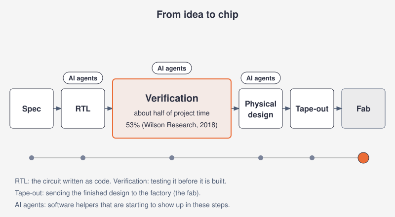
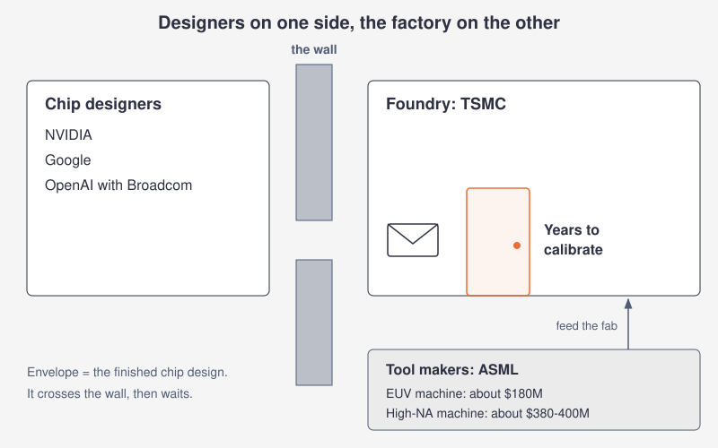
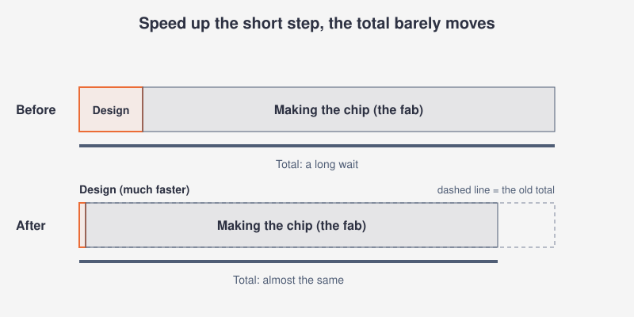
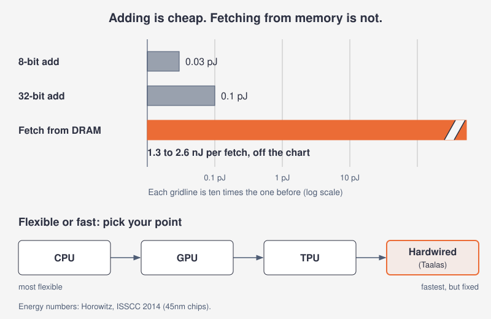
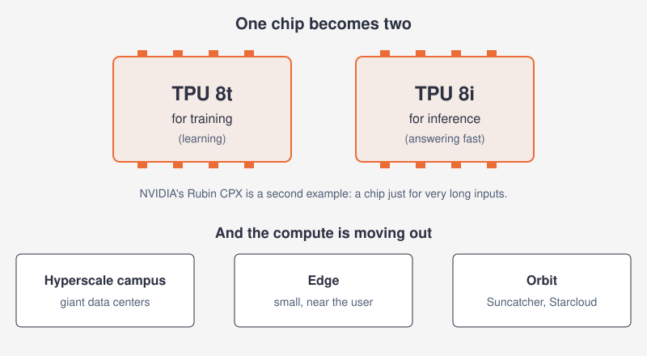
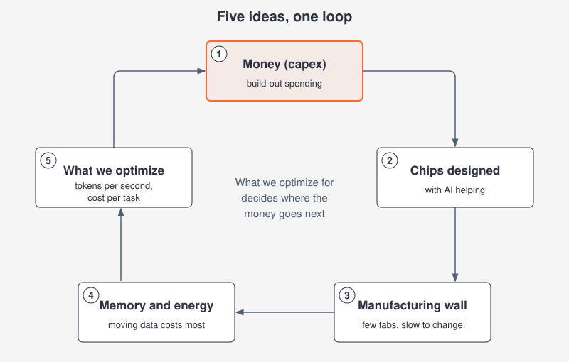

# Who builds the brains? The Sundai Hack 145 chip panel, explained simply

> **Animated version:** https://wilsonwu-ai.github.io/sundai-145-panel-explained/

*AI can already help design chips. The harder questions are who can build them, how fast, and what they should be built to do.*

## The whole panel in 30 seconds

The two hosts of Sundai Hack 145 spent an hour at MIT CSAIL in October 2026 talking about where AI meets chip design, chip factories and data centers. Their main argument: AI is about to make *designing* chips much faster, but *manufacturing* them is the slow part, so that is where the real bottleneck sits. Around that core, they argued about memory, energy, what a data center should optimize for, and who ends up making money.

I was in the room. Below, each idea starts with a simple picture, then what the hosts said, then what the research found. Where the two disagree, there is a "Fact check" box.

## 5 big ideas

There are 5 topics. Topic 1 has 5 points, topic 2 has 4, topic 3 has 4, topic 4 has 5, and topic 5 has 4.

1. AI is learning to design chips.
2. The factory, not the design, is the wall.
3. Custom chips win because moving data is expensive.
4. "Fast" depends on the job.
5. The money, the cycles, and the split into specialist chips.

## 1. AI is learning to design chips

> Imagine a spelling test that comes with an answer key. A computer can grade its own answers, so it can practice a million times without a teacher. Chip design has an answer key too: a simulator tells you whether the circuit works. That makes it a great thing for AI to practice on.

### What the hosts said

- **People stay in the loop for a while.** One host thought humans will still be needed for years, even as automation creeps up the whole stack, from spec (the written description of what the chip should do) to finished design: "So I think maybe 2030 will be still necessary, or maybe a bit longer." [03:52]
- **Chip design is made for AI training.** Every stage produces a number you can check, so no human judge is needed: "the beautiful thing about all the chip design thing is all verifiable rewards." [04:13]
- **The catch is data.** Companies guard their design files, so progress will likely happen inside companies rather than in public models: "no one wants to share because it's their main IP." [04:32]
- **A story from the room.** One host told of a friend at Anthropic who gave Claude a short prompt to design a systolic array (a grid of simple math units, the core of many AI chips), find a vendor and handle tape-out (sending the final design to the factory). The punchline: "he got the chip a week later back in San Francisco." [05:55] (Unverified: research found no public record of this story; see the Fact check below.)
- **Verification is the big prize.** Verification means writing huge piles of tests to prove a design works. One host said it eats most of the effort: "And this takes 70% and takes months." [07:49] Because it is a search through huge numbers of combinations, they argued AI suits it well, and one host predicted that "chip design could be almost solved" within a few years. [07:02]

### What the research says

- An academic survey of AI agents for chip design ([arXiv, Dec 2025](https://arxiv.org/html/2512.23189v2)) backs the hosts on two points. No AI agent has yet taken an industrial chip all the way to tape-out without humans, and good industrial data is locked inside companies. It places autonomous flows for single blocks (not whole chips) 3 to 5 years out, if benchmarks improve.
- The "verifiable rewards" idea is published. QiMeng-CodeV-R1 trains an AI to write chip code using automatic tests as the grader. Its 7B model reports 68.6% on one benchmark (VerilogEval v2) and 72.9% on another (RTLLM v1.1) ([arXiv, May 2025, revised Feb 2026](https://arxiv.org/abs/2505.24183)). That covers small pieces of chip code, not whole chips.
- Vendors are moving fast, with vendor numbers. Synopsys, with NVIDIA, announced an agent for chip verification and claims up to 50X faster time to validated chip code (RTL) than traditional verification workflows ([Synopsys, Jul 2026](https://news.synopsys.com/2026-07-26-Synopsys-Showcases-Comprehensive-Autonomous-Engineering-Workflows-from-Silicon-to-Systems,-Developed-with-NVIDIA-Technology)). The startup ChipAgents expanded its Series A to $134 million and says it is deployed at more than 120 chip companies ([VCA, Jul 2026](https://www.vcaonline.com/news/2026072902/chipagents-expands-series-a-funding-to-134-million-as-demand-grows-for-agentic-ai-in-semiconductor-design/)). These are company claims, not independent measurements.
- The closest documented path from AI-written chip code to real silicon was slower than a week. In one student competition, teams used AI to write the code, design phases ran January to April 2026, and eleven designs were submitted for manufacturing ([arXiv, Oct 2026](https://arxiv.org/html/2610.18891)).

> **Fact check:** Two gentle corrections. First, the 70% figure is folklore. The researcher behind the best-known industry survey wrote that the number opens nearly every verification paper but has no traceable source; his surveys found 50% in 2007 and 55% in 2010 ([Siemens, Apr 2011](https://blogs.sw.siemens.com/verificationhorizons/2011/04/03/part-4-the-2010-wilson-research-group-functional-verification-study/)). The latest figure I could check is 53% of project time in 2018 ([Siemens, Jan 2019](https://blogs.sw.siemens.com/verificationhorizons/2019/01/29/part-8-the-2018-wilson-research-group-functional-verification-study/)). So "about half" is right and "about 70%" is not. Second, the chip-in-a-week story: research found no public record of it, with no post, vendor or shuttle named. What is public is that Anthropic hired in July 2026 for a Chip Design RL role that builds AI training setups for chip design and verification ([Anthropic job post, Jul 2026](https://job-boards.greenhouse.io/anthropic/jobs/5231612008)). That points the same direction as the story, but it does not prove it. Treat the story as unverified. Third, the prediction that chip design could be "almost solved" in three or four years is more optimistic than the survey, which sees autonomous flows only for single blocks in 3 to 5 years.

### Why it connects

If AI makes design fast, the next question is whether anyone can manufacture all those new designs, which is topic 2.

## 2. The factory, not the design, is the wall

> A chip design is a recipe, and a chip factory is a giant kitchen with one very expensive oven. AI can write a thousand recipes overnight. But the oven takes ages to learn, and the kitchen can only cook so much. More recipes do not help if the oven is the slow part.

### What the hosts said

- **There is a wall between designers and makers.** Most chip companies design, and a separate company builds: "NVIDIA doesn't produce their own chips." [01:07] The building side runs on machines that are slow to tune.
- **The machines are pricey and slow to calibrate.** On ASML's EUV machines (the tools that print chip patterns with extreme ultraviolet light), one host said "they sell their machines for 400 million per machine." [01:47] They added that machines bought a year and a half to two years ago are only now working, which locks factories into the processes they already have.
- **The biggest factory cannot afford to experiment.** One host argued TSMC runs fixed recipes at full demand, and pausing to try new ideas would cost "hundreds of millions of dollars for them just to try it out." [12:20] So new ideas get tested in smaller factories. Elsewhere they called the industry slow to turn: "processing industry is an oil tanker." [38:32]
- **Fix the slowest step first.** This is Amdahl's law (speeding up one part of a job only helps as much as that part's share of the total): "you should always focus on the thing which takes the longest time to optimize." [40:00] They named a second bottleneck too: "there is a huge lack of talent." [48:39]

### What the research says

- The 400 million price matches High-NA EUV, the newest version. One trade report put High-NA at about $380 million, more than twice the roughly $180 million of the previous generation ([eeNews Europe, Mar 2024](https://cdn.eenewseurope.com/en/intel-video-shows-high-na-euv-lithography-machine-installation/)). A market piece puts High-NA at about $400M and says TSMC does not need High-NA for its next several processes ([iTiger, Jul 2026](https://www.itiger.com/news/1163873712)). ASML does not publish prices, so these are press figures.
- Bringing a machine up is a real project. Intel finished acceptance testing on a High-NA scanner against a target of 175 wafers per hour ([Bits&Chips, Dec 2025](https://bits-chips.com/article/intel-begins-acceptance-testing-of-asmls-exe5200b-high-na-euv-scanner/)). Acceptance is not the same as full process qualification.
- TSMC really is full. Its 3nm capacity was fully committed for 2026, and demand for its advanced packaging is about 1 million wafers in 2026 versus about 370,000 in 2024 ([TechTimes, Jul 2026](https://www.techtimes.com/articles/320348/20260713/tsmc-sets-all-time-revenue-record-ai-demand-has-rewritten-its-calendar.htm)).
- Masks (the stencils used to print a chip) cost millions. One estimate lists $10M to $20M for a mask set at 3nm to 5nm ([Silicon Analysts, Mar 2026](https://siliconanalysts.com/analysis/fabless-startup-tapeout-cost-guide)).
- The talent gap is documented. An industry group projects about 67,000 US chip-industry jobs at risk of going unfilled by 2030 ([SIA, Jul 2023](https://www.semiconductors.org/chipping-away-assessing-and-addressing-the-labor-market-gap-facing-the-u-s-semiconductor-industry/)). That covers the whole industry, not chip designers alone.
- OpenAI's chip program is real. OpenAI designs the chip and Broadcom handles manufacturing, networking and system integration, aiming at 10 GW of accelerators by 2029 ([Maginative, Oct 2025](https://www.maginative.com/article/openai-and-broadcom-to-co-design-custom-ai-chips-deploy-10-gw-by-2029/)).

> **Fact check:** "400 million per machine" is a High-NA price. The previous-generation (lower-NA) machines were about $180 million in the same 2024 report, and a current price for those machines was not confirmed ([eeNews Europe, Mar 2024](https://cdn.eenewseurope.com/en/intel-video-shows-high-na-euv-lithography-machine-installation/)). The research also could not confirm the "year and a half to two years" calibration time or the cost of TSMC pausing to experiment. They may be true inside the industry; they are just not on the public record.

### Why it connects

If the factory is the slow step, every chip that does get made needs to count, which is why topic 3 is about squeezing more out of each one.

## 3. Custom chips win because moving data is expensive

> A chef can chop vegetables in a blink, but the fridge is down the street. Most of the time and energy goes into walking to the fridge, not cooking. Custom chips put the groceries on the counter, or build the recipe into the kitchen itself, so you stop walking.

### What the hosts said

- **Small open factories may move first.** One host argued that the first solution for fast custom chips "is going to come from all these open PDKs." [08:26] A PDK (process design kit) is the rulebook for a factory's process. The hosts said open ones avoid the secrecy contracts of the biggest foundries, though shared open runs still have fixed deadlines.
- **Some startups bake the model into the chip.** They described efforts "where you're trying to bake the architecture either of the transformer itself or the specific weights directly into the chip." [09:18] The open question is whether raw speed or this narrow efficiency wins.
- **A custom chip example.** One host described OpenAI's chip running a model at about 700 tokens per second against about 120 on the fastest GPU: "So at least in this setup, it's 7x." [15:40]
- **The memory wall.** Math is cheap; fetching data from memory is expensive. Compared with a tiny adder, reading from memory is, in one host's words, "like a thousand times more." [16:20] As a middle path, they pointed to reprogrammable chips, "adaptable architectures like FPGAs." [45:35]

### What the research says

- The energy gap is well measured. A classic 2014 conference talk lists a 32-bit add at 0.1 pJ (picojoules, trillionths of a joule) and an 8-bit add at 0.03 pJ, versus 1.3 to 2.6 nJ (nanojoules, a thousand times bigger units) for a DRAM memory access ([Horowitz, Feb 2014](https://www.gwern.net/doc/cs/hardware/2014-horowitz-2.pdf)). Those are older-chip numbers, but the gap persists.
- The hardwiring startup is Taalas. Its first chip builds Llama 3.1 8B straight into silicon, and Taalas claims 17K tokens per second per user at roughly 10x less power ([Taalas, Feb 2026](https://taalas.com/the-path-to-ubiquitous-ai/)). Those are vendor claims, and another outlet quoted a lower speed. AMD then agreed to acquire Taalas; completion is unconfirmed as of this writing ([AMD, Aug 2026](https://ir.amd.com/news-events/press-releases/detail/1296)).
- OpenAI's chip is called Jalapeño, built with Broadcom, with first deployment targeted for late 2026. At its debut OpenAI gave no tokens-per-second figure and promised a technical report ([DBTA, Jun 2026](https://www.dbta.com/Editorial/News-Flashes/OpenAI-and-Broadcom-Debut-LLM-Optimized-Inference-Chip-175457.aspx)).
- The memory wall shows up in markets. SK hynix reported Q2 2026 operating profit up about 557% from a year earlier, and conventional DRAM contract prices rose about 93 to 98% quarter on quarter in Q1 2026, per an aggregator not checked against filings ([IntuitionLabs, Sep 2026](https://intuitionlabs.ai/articles/hbm-dram-ai-memory-demand)).
- Memory on the chip, at a price. An OpenAI coding model runs at over 1,000 tokens per second on Cerebras hardware, which keeps its memory on one giant chip. The hosts noted such approaches are fast but cost more energy per token, and the source gives no GPU comparison ([The Register, Feb 2026](https://www.theregister.com/2026/02/12/openai_model_cerebras/)).
- Open factories are real and cheap, but old. One shared run on a 180nm process sells 1,000 dies for $2,000 to $8,000 ([Crowd Supply, Aug 2026](https://www.crowdsupply.com/wafer-space/gf180mcu-run-3)). That suits learning and small parts, not frontier AI chips.

> **Fact check:** On memory, the host if anything undersold it. For a bare 32-bit add, the 2014 table implies a DRAM access costs roughly 10,000 times more or higher, though "about a thousand" is the right order of magnitude ([Horowitz, Feb 2014](https://www.gwern.net/doc/cs/hardware/2014-horowitz-2.pdf)). On the OpenAI chip, the research could not trace the 120 versus 700 tokens per second (7x) comparison to a published source, and OpenAI gave no speed figure at launch ([DBTA, Jun 2026](https://www.dbta.com/Editorial/News-Flashes/OpenAI-and-Broadcom-Debut-LLM-Optimized-Inference-Chip-175457.aspx)). Treat the 7x as unverified.

### Why it connects

Once you can make a chip faster or cheaper, you have to decide which of those you actually want, which is topic 4.

## 4. "Fast" depends on the job

> Think of a printer. Tokens per second is how fast pages come out, and cost per token is the price of ink. Some people pay extra for express printing; others are happy to wait. And a printer on the Moon mostly just needs to survive.

### What the hosts said

- **The target keeps moving.** First it was raw compute, then "electricity consumption slash cost per token is very important," and then speed itself became something people pay extra for. [17:01] (A token is a small chunk of text a model reads or writes.)
- **Space changes the rules.** For data centers in orbit, the hosts said, delay barely matters. Surviving radiation that flips bits, and extreme temperatures, is what counts. [18:06]
- **Agents stress the wiring.** One host said it is "impossible to run an agent on one GPU," so the links between chips (the interconnect) become the thing to optimize. [19:16]
- **Count the scratch paper.** Reasoning models can write long hidden chains of thought even for simple questions, so one host proposed measuring "tokens per difficulty, tokens per task." [22:52]
- **Benchmarks need secret questions.** Because public tests get gamed, they pointed to setups "where they have half of the benchmark is open" and the rest hidden. [24:46]

### What the research says

- Speed is already sold as a premium. On the same open model, Cerebras serves about 1,754 tokens per second at a blended $0.39 per million tokens, versus Groq at about 473 tokens per second for $0.14 ([Artificial Analysis, fetched Oct 2026](https://artificialanalysis.ai/providers/cerebras)). Anthropic's fast mode for Claude Opus 5.5 costs $8 input and $40 output per million tokens versus the standard $4 and $20, for up to 2.5x higher output speed ([Anthropic docs, fetched Oct 2026](https://platform.claude.com/docs/en/build-with-claude/fast-mode)).
- Google tested its TPUs (its own AI chips) in a proton beam for its Suncatcher space project. Memory was the most sensitive part, with no problems until 2 krad(Si) of radiation, and two prototype satellites are planned by early 2027 ([Google Research, Nov 2025](https://research.google/blog/exploring-a-space-based-scalable-ai-infrastructure-system-design/)).
- Space compute is attracting money and filings. Starcloud raised $250M at a $2.3B valuation, with its first Starcloud-2 satellite booked for January 2027 ([Implicator, Aug 2026](https://www.implicator.ai/starcloud-raises-250-million-at-2-3-billion-valuation-to-buy-launch-capacity/)). SpaceX filed for up to 1 million orbital data-center satellites, though one analyst called the idea speculative ([Via Satellite, Feb 2026](https://www.satellitetoday.com/connectivity/2026/02/02/spacex-files-for-orbital-data-center-satellites-amid-xai-merger-reports/)).
- The wiring is a product. NVIDIA's Vera Rubin NVL72 rack ties 72 GPUs and 36 CPUs together and is pitched at agent workloads ([NVIDIA, Mar 2026](https://investor.nvidia.com/news/press-release-details/2026/NVIDIA-Vera-Rubin-Opens-Agentic-AI-Frontier/)).
- Tokens per task already appears on some leaderboards. Artificial Analysis notes one model generated 210M tokens on its test suite against a median of 130M, at $2.01 per task ([Artificial Analysis, fetched Oct 2026](https://artificialanalysis.ai/models/glm-5-3)).

> **Fact check:** ARC's benchmark is not quite half open, half closed. ARC-AGI-2 has 120 public evaluation tasks and 240 hidden ones (120 semi-private plus 120 private), so hidden tasks outnumber public ones two to one ([ARC Prize, fetched Oct 2026](https://arcprize.org/arc-agi/2/)). The spirit of the point holds: keep part of the test secret.

### Why it connects

What you optimize for decides what gets built and who pays for it, which brings us to the money in topic 5.

## 5. The money, the cycles, and the split into specialist chips

> When every lemonade stand sees lemons selling out, they all plant lemon trees. Years later the trees ripen at once, there are too many lemons, and prices crash. Chip factories take years to build, so they often get the timing wrong in the same way.

### What the hosts said

- **Who captures the value.** Looking back, one host argued that chips were commodities ("memory was completely commodity") and the hyperscalers (giant cloud companies) took the profit. [32:44] They also said these companies are moving data centers off their own books.
- **Expect a boom and a bust.** Memory and logic chips always run in cycles, and one host said "that cycle will be 4 to 6 years," possibly bigger this time. [33:37]
- **More small data centers near the action.** Because signals still take time to travel, "we'll have more edge data centers," for example near hospitals, as long as the economics work. [36:13]
- **Chips are splitting by job.** On Google: "they announced two different TPUs," one for training (teaching a model) and one for inference (using it). [37:46] More splits may follow, but factory limits slow that down.

### What the research says

- The spending is huge. Meta guided 2026 capex (spending on buildings and equipment) to $130 to 145 billion ([Meta, Jul 2026](https://investor.atmeta.com/investor-news/press-release-details/2026/Meta-Reports-Second-Quarter-2026-Results/)). Amazon raised its 2026 capex to about $220B from $200B, mainly on higher memory costs, and said capacity will still fall short of demand in 2026 and 2027 ([Fortune, Jul 2026](https://fortune.com/2026/07/30/andy-jassy-amazon-capex-demand-aws-pga-tour/)).
- Off-the-books data centers are real. Meta and Blue Owl formed a roughly $27B joint venture for a Louisiana campus, with Blue Owl owning 80% and Meta leasing the buildings ([Bisnow, Oct 2025](https://www.bisnow.com/news/national/data-center-capital-markets/meta-pushes-its-largest-data-center-project-off-its-books-with-27b-joint-venture-131490)).
- The split is happening. Google's eighth-generation TPUs come as TPU 8t for training (one superpod scales to 9,600 chips) and TPU 8i for inference, with up to 2x performance per watt over the prior generation ([Google, Apr 2026](https://blog.google/innovation-and-ai/infrastructure-and-cloud/google-cloud/eighth-generation-tpu-agentic-era/)). NVIDIA's Rubin CPX is a GPU aimed at very long-context inference, with 128GB of memory, expected at the end of 2026 ([NVIDIA, Sep 2025](https://nvidianews.nvidia.com/news/nvidia-unveils-rubin-cpx-a-new-class-of-gpu-designed-for-massive-context-inference)).
- Edge estimates vary by definition. One firm projects the edge data center market growing from USD 50.86B in 2025 to USD 109.20B by 2030 ([MarketsandMarkets, Sep 2025](https://www.marketsandmarkets.com/PressReleases/edge-data-center.asp)).
- Someone in the audience asked about chips for decentralized agent networks, naming MIT's Project NANDA. NANDA is a Media Lab effort with 18 institutions to build a network of AI agents, and its page describes software protocols, not hardware ([MIT Media Lab, page undated](https://www.media.mit.edu/projects/mit-nanda/overview/)).

> **Fact check:** The cycle is real, but the research does not confirm "4 to 6 years." One analysis says past memory supercycles tended to peak and turn down within one or two years, while calling this one larger and longer than usual ([SemiAnalysis, Feb 2026](https://newsletter.semianalysis.com/p/memory-mania-how-a-once-in-four-decades)). And for now Amazon's CEO says capacity will still fall short of demand in 2026 and 2027, not that it is overbuilt ([Fortune, Jul 2026](https://fortune.com/2026/07/30/andy-jassy-amazon-capex-demand-aws-pga-tour/)).

### Why it connects

Money flowing into AI, from data-center spending to startup funding like ChipAgents, is part of what drives topic 1's AI design tools, which closes the loop.

## How the 5 ideas fit together

Read the five topics as one loop. Money (capex) funds new chips. AI makes designing them faster. The factory wall limits how many get made. Memory and energy limits decide what a good chip looks like. And the choice of what to optimize, tokens per second or cost per task, decides what buyers will pay for, which sends money back to the start.

The hosts' sharpest point is Amdahl's law applied to design versus manufacturing. Faster design is exciting, but the whole process only moves as fast as its slowest link, and today that link is manufacturing.

## Words to know

- **HBM:** high-bandwidth memory, stacked memory chips placed right next to an AI chip to feed it data fast.
- **EUV:** extreme ultraviolet lithography, machines that print the tiniest chip patterns with very short-wavelength light.
- **Tape-out:** the moment a finished chip design is sent to the factory; mistakes after this are costly.
- **RTL:** register-transfer level, the code that describes what a chip's circuits do, written before physical layout.
- **Systolic array:** a grid of simple math units that pass numbers to their neighbors, used in many AI chips.
- **Chiplet:** a small chip designed to be combined with others in one package instead of building one giant chip.
- **Interposer:** a thin base layer that wires chiplets and memory to each other inside a package.
- **TPU:** tensor processing unit, Google's own chip built for AI math.
- **Inference:** using a trained AI model to answer questions, as opposed to training it.
- **Amdahl's law:** speeding up one part of a job helps only as much as that part's share of the total time.
- **Verifiable reward:** a score a computer can check automatically, like a test with an answer key, used to train AI.
- **Capex:** capital expenditure, money spent on long-lasting things like buildings, machines and chips.

## How this was made

I recorded the panel on my phone and transcribed it locally with Whisper. Five research lanes then checked the hosts' claims against public sources, and two adversarial fact-checkers tried to knock each finding down. Of 40 claims checked, 0 were killed and 24 were corrected, and key numbers were re-checked against the source pages wherever the pages could be fetched. Vendor and aggregator figures are flagged as such. Every fact here comes from the verified fact sheet: [research/facts.md](research/facts.md). The hosts are not named because their names are unconfirmed. If you spot an error, I would like to know.
